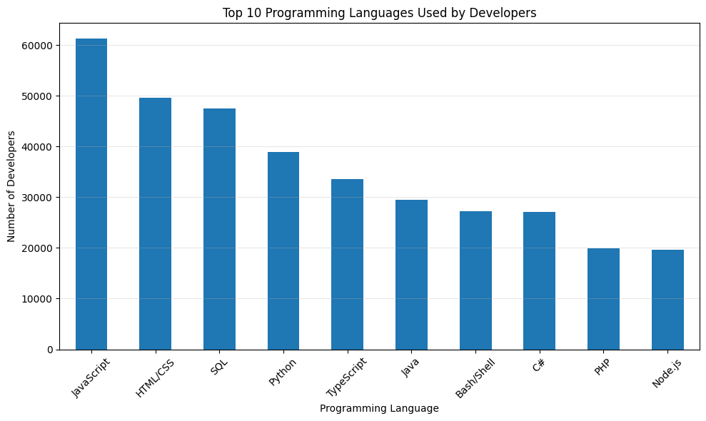

# Technology Job Market Trends Analysis

An exploratory data analysis of the **Stack Overflow Developer Survey** (224,000+ responses) to understand where the technology industry is heading.

The raw survey data was cleaned and preprocessed (missing values, inconsistent categories, multi-answer columns), then analyzed to find trends in programming language popularity, developer roles and the job market. The results are shown through Matplotlib visualizations and a written summary of key insights for students and developers choosing what to learn next.

## Technologies
Python · Pandas · Matplotlib · Jupyter Notebook

## Main Features
- Large dataset cleaning and preprocessing
- Statistical analysis
- Language popularity trends
- Developer role analysis
- Job market insights
- Data visualizations

